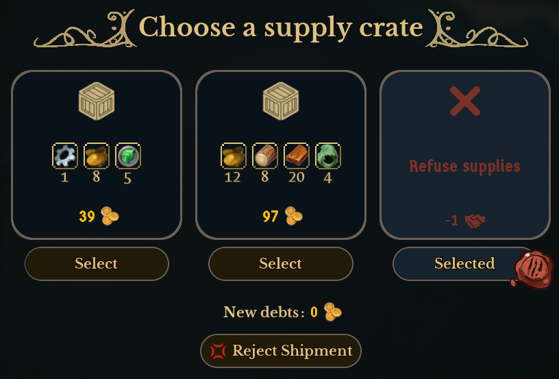

# DeclineSupplyShipDefault

A quality-of-life mod for [Whiskerwood](https://store.steampowered.com/app/2489330/Whiskerwood/).

**No more accidental supply debt.** When the Claws' supply ship docks ("Choose a supply crate"), the game pre-selects the first crate, and every crate adds debt that you owe at the next tax collection. With this mod **Refuse supplies** is selected instead as soon as the supply ship arrives: *New debts: 0*, and the window's button reads **Reject Shipment**. Want a crate? Open the ship and pick one, exactly as before.

## Features

- **Refuse supplies is the default choice** of every new supply ship.
- You can still **pick any crate yourself**.
- Uses the game's own crate selection (the same as clicking *Select* on the Refuse supplies card); nothing else changes.
- **No effect on performance:** the mod only does something when a ship arrives at your main dock.
- Mods menu option **Supply ship - Refuse supplies selected by default** (On / Off, default On).

Refusing the shipment costs 1 standing with the Claws, the same as when you refuse it yourself.

## Installing

- **Steam Workshop:** subscribe. That's all.
- **Manually:** put `DeclineSupplyShipDefault.pak` and `DeclineSupplyShipDefault.uplugin` in
  `%localappdata%\Whiskerwood\Saved\mods\DeclineSupplyShipDefault\` (create the folder; the file names must stay as they are).

## Known limitations

- Tested on game version 0.7.207 (UE 5.8).
- A supply ship that is already docked when you load a save is left as it is.
- Only the crate-choice supply ship is changed; the starting supplies at the beginning of a game are not.

## Version history

- **1.0** – first release.

## Debug logging

The mod logs nothing by default. To see what it does, create
`%localappdata%\Whiskerwood\Saved\mods\DeclineSupplyShipDefaultConfig\debug.txt` containing any text (e.g. `1`; an empty file counts as off).
It is read when a save finishes loading; log lines go to `%localappdata%\Whiskerwood\Saved\Logs\modlog.txt`.
(The mod API's `ReadModTextFile` adds `.txt` to the name it is given, so the mod asks for `debug`.)
The Workshop upload never contains the Config folder, so published copies stay silent.

## For modders

### Repository layout

| Path | What |
|---|---|
| `Mod/DeclineSupplyShipDefault/` | The mod's source assets (`.uasset`) and `DeclineSupplyShipDefault.uplugin`. This is the whole mod. |
| `docs/graphs/` | Blueprint graphs as copy-paste text (T3D). Reference only: the `.uasset` files are the source of truth. |
| `tools/` | `t3d.py` + `declinesupplyshipdefault_build.py`: Python generator that writes the graphs from the modkit's reflection dump. |
| `workshop/` | SteamCMD item file (`DeclineSupplyShipDefault.vdf`) and [upload steps](workshop/HOW_TO_UPLOAD.md). The preview image is `docs/screenshot.png`. |
| `sync-from-modkit.bat` | Copies the mod's assets from the modkit into this repo and stages the built `.pak` + uplugin into `workshop/content/`. |
| `sync-to-steam.bat` | Uploads `workshop/content/` to the Workshop with SteamCMD. |

### Building from source

1. Set up the official [Whiskerwood modkit](https://github.com/Whiskerwood-Modding/Whiskerwood-Project) (custom UE 5.8 build).
2. Copy `Mod/DeclineSupplyShipDefault/` from this repo to `Content/Mods/DeclineSupplyShipDefault/` in the modkit project.
3. Right-click the folder → **Cook & Install** (Mod Tools). The mod uses pak chunk 27 (`PAL_DeclineSupplyShipDefault`).
4. After editing in the editor, run `sync-from-modkit.bat` to copy the changed assets back, then commit.

Assets:

- `BP_Startup`: **Actor** Blueprint, registers the Mods menu option `DeclineSupplyShipDefault_On`.
- `BP_MapLoad`: **Actor** Blueprint, all the logic.
- `PAL_DeclineSupplyShipDefault`: Primary Asset Label, Chunk ID 27, *Label Assets In My Directory* on, Cook Rule *Always Cook*.

`python tools/declinesupplyshipdefault_build.py` writes the paste text into `tools/out/` (copies in `docs/graphs/`). It needs the modkit's `Content/DynamicClasses/Whiskerwood-*.jmap.gz`; set `JMAP=...` if it isn't next to this repo. `TRACE` / `DIAG` at the top switch on development-only log lines. In the asset's event graph: Ctrl+A, Delete, Ctrl+V, then compile.

`BP_MapLoad` variables (create them before pasting):

| Variable | Type |
|---|---|
| `Debug` | Boolean |
| `Sys` | Arco Systems, object reference |
| `Panel` | Docked Boat Panel Supply Trader, object reference |
| `Choices` | Supply Ship Choice (structure), **array** |
| `CurIdx` | Integer |
| `RejectIdx` | Integer |
| `Tries` | Integer |
| `RetryPending` | Boolean |
| `ShipType` | Integer |

If a red event wire (OnLoaded, OnShipChanged → its *Bind Event* node) pastes unconnected, drag it again.

### How it works

- **Event:** at load the mod takes `ArcoSystems.GetArcoSys()` → `GetPrimaryDockActor()` → its `FactionDock` component and binds `DockedShipChanged(shipTypeAtDock)`, which fires when a ship arrives at (or leaves) the main dock. Nothing runs between ship arrivals: no tick, no polling. Only ship type 3 (`SUPPLY_SHIP_TRADE`, the crate ship) is handled.
- **Reading the ship:** 0.5 game seconds after it docks, `ArcoSystems.GetCurrentlyDockedShipInfo()` → `asSupplyShip` (`SupplyShipState`): `choices` (each `SupplyShipChoice` has `isRejectChoice`) and `choiceIdx` (the selected one). If the choices aren't filled in yet, it checks again after 1 game second (at most 3 checks).
- **Selecting:** the crate window class `DockedBoatPanel_SupplyTrader` handles the HUD action `chooseSupplyPackage` in its `ReceiveHudAction` (`paramInt` = choice index; the game turns it into its own "choose supply index" command, the same one the window's *Select* buttons use). The mod keeps one invisible instance of that class and sends `chooseSupplyPackage` with the index of the reject choice. (`DockedBoatPanel_Supplies` is the *starting supplies* window and doesn't know this action.)

## Credits

Created by rinku using the Whiskerwood modkit: https://github.com/Whiskerwood-Modding/Whiskerwood-Project
